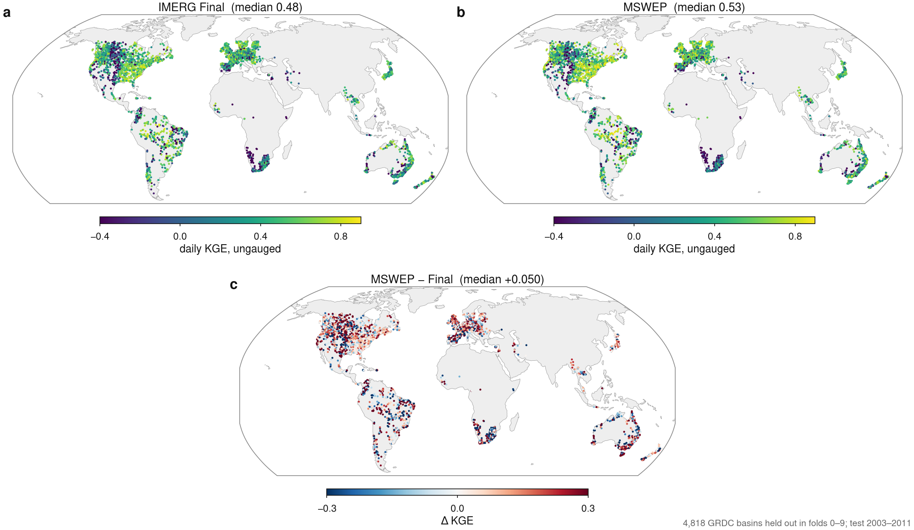

# crest-global-params

Global 0.1° parameters for the CREST hydrologic model, in two versions: one trained with **IMERG V07B Final** precipitation and one with **MSWEP V2.8**. A small Python runner reproduces the model the parameters were trained with, and eight example basins with openly licensed observations run out of the box.

The parameters come from **dCREST**, a differentiable CREST-Phys model. A convolutional network maps 22 static attributes to 15 parameters per 0.1° cell. It was trained end to end on daily discharge at 5,021 GRDC basins, with every forcing product trained on the same basins. Every land cell gets parameters, gauged or not.

> Version 1.0.0 (2026-10-20). The accompanying paper is in preparation; numbers may be refined in later versions.

## What is here

| Path | Contents |
|---|---|
| `crest_global/` | Python package: `model.py` (dCREST forward model), `forcing.py` (Snow-17, PET, readers for IMERG / MSWEP / ERA5), `params.py`, `basin.py`, `metrics.py` |
| `examples/cases/` | 8 example basins, each with cells, 2001–2023 IMERG Final + ERA5 forcing, openly licensed observed discharge, parameters, reference simulations, skill and a hydrograph figure |
| `examples/run_case.py` | Runs one case |
| `scripts/run_basin.py` | Any basin: polygon → cells → forcing → simulation |
| `tests/test_fidelity.py` | Checks that the package reproduces the training runs |
| `docs/` | Global skill and parameter maps |
| Release assets (`v1.0.0`) | `crest_global_params_imerg_final_v1.nc`, `crest_global_params_mswep_v1.nc` (~100 MB each), `crest_global_static_v1.nc` |

## Quick start

```bash
pip install numpy torch h5py netCDF4 shapely matplotlib pytest
python examples/run_case.py GRDC_6139155            # released IMERG Final parameters, shipped forcing
python examples/run_case.py GRDC_6139155 --heldout  # the network that never saw this basin
python -m pytest -q tests                            # about 2 min; all 8 cases must pass
```

For any other basin:

```bash
gh release download v1.0.0 -R Skyan1002/crest-global-params -p '*.nc' -D data
# or without gh:
#   wget -P data https://github.com/Skyan1002/crest-global-params/releases/download/v1.0.0/crest_global_params_imerg_final_v1.nc
#   (same for crest_global_params_mswep_v1.nc and crest_global_static_v1.nc)
python scripts/run_basin.py cells basin.geojson cells.npz
python scripts/run_basin.py forcing cells.npz --imerg-dir IMERG/ --era5 'ERA5/t2m_*.nc' \
       --start 2001-01-01 --end 2020-12-31 forcing.npz
python scripts/run_basin.py run cells.npz forcing.npz data/crest_global_params_imerg_final_v1.nc q.csv
```

In Python:

```python
from crest_global import params, forcing, model
fields, _ = params.open_paramset("data/crest_global_params_imerg_final_v1.nc")
p = params.sample(fields, R, C)                     # R, C: cell rows/columns on the 0.1° IMERG grid
melt, pet = forcing.model_inputs(precip_mm_day, t2m_c, elev_m, lat, dates)
q = model.simulate(p, melt, pet, cell_weights, area_km2)   # mm/day; model.to_m3s(q, area_km2) for m3/s
```

**Use the forcing that matches the parameter set:** IMERG V07B Final daily with `imerg_final`, MSWEP V2.8 daily with `mswep`. The parameters partly compensate for each product's biases (the precipitation multiplier `pm` and `ke` in particular), so they do not transfer between products.

Start simulations at least two years before the period you analyse. Training started on 2001-01-01 and scored nothing in the first two years.

## The model

All 15 parameters are given per 0.1° cell. They are **effective** parameters of this model structure, not field measurements.

| Name | Meaning | Units | Range in the model |
|---|---|---|---|
| `wm` | soil water capacity W_M | mm | 1–2000 |
| `b` | variable-infiltration-curve exponent | – | 0.01–6 |
| `im` | impervious fraction | – | 0–0.5 |
| `ke` | PET multiplier K_E | – | 0.2–2.5 |
| `fc` | infiltration / recharge capacity FC | mm h⁻¹ | 0–150 |
| `ksoil` | soil → aquifer drainage rate | d⁻¹ | 0–0.5 |
| `hmaxaq` | aquifer capacity | mm | 50–4000 |
| `gwc` | baseflow coefficient | mm d⁻¹ | 0.01–5 |
| `gwe` | baseflow exponent | – | 0.5–6 |
| `ft` | canopy/wetland store as a fraction of W_M | – | 0–0.7 |
| `qc` | fast-flow store outflow fraction per day | – | 0.05–1 |
| `lf` | loss factor on cell runoff | – | 0–0.5 |
| `pm` | precipitation multiplier, constant in time | – | 0.7–1.4 |
| `nshape` | gamma unit-hydrograph shape | – | 1–8 |
| `kmult` | multiplier on the geomorphic lag 0.35 (A/1000)^0.38 days | – | 0.1–4 |

Each file also holds `<name>_spread`, the fold-to-fold relative IQR over the ten networks. The precipitation multiplier (0.07–0.09) and `ke` (0.24) are stable. `fc` and `gwc` are not (0.55–0.96 with either product), nor is `ksoil` with MSWEP (0.85), so do not interpret those alone.

**Daily chain per cell.**
1. Snow-17 with default global parameters turns precipitation and ERA5 2 m temperature into liquid input. The two EF5 defects (seasonal melt factor and double dt/6) are fixed, and the seasonal melt factor is shifted half a year in the southern hemisphere.
2. Liquid input is multiplied by `pm`.
3. A small canopy/wetland store fills and evaporates first.
4. The CREST-Phys water balance follows: variable infiltration curve, aquifer with fill-and-spill and exponential baseflow, and EF5's runoff partition.
5. Fast flow passes a linear store (`qc`), and total runoff is reduced by `lf`.

**Per basin.** Cell runoff is averaged with the cells' area fractions and routed with a gamma unit hydrograph (30 days).

PET is temperature based (Oudin type, 0.408·Ra·(T+5)/100). The runoff-generation parameters (`wm` … `gwe`) follow the CRESTPHYS water balance of the EF5_mchen fork (`CRESTPhysModel.cpp`). Routing differs from EF5's kinematic wave, so `ft`, `qc`, `lf`, `pm`, `nshape` and `kmult` are specific to this model.

**How the parameters were made.**
- Network: two 3×3 convolutions (128 channels) and a 1×1 head over 22 global attributes (climate, soil, land cover, terrain). The receptive field is about 0.5°.
- Loss: (1 − KGE) capped at 2, plus 2(β − 1)², summed over training basins; 1,024 iterations; gradients pass through routing and CREST.
- Folds: GRDC basins are grouped by nesting into ten folds. Each fold's network is trained on 2012-01-01 to 2020-12-30 and tested on held-out basins in 2003–2011.
- The released field is the median over the ten fold networks.

## How good is it

Ten-fold cross-validation: 4,818 GRDC basins never used in training, daily KGE, test period 2003–2011.

| Forcing | median KGE | humid basins > 500 km² | β (mean flow ratio) | KGE > 0.5 |
|---|---|---|---|---|
| IMERG V07B Final | 0.479 | 0.604 | 0.97 | 47% |
| MSWEP V2.8 | 0.529 | 0.650 | 0.97 | 53% |

By WMO region (median KGE, Final / MSWEP): Europe 0.57 / 0.62, Asia 0.49 / 0.56, North and Central America 0.47 / 0.53, South America 0.43 / 0.47, SW Pacific 0.32 / 0.43, Africa 0.13 / 0.06.

Dry basins (PET/P ≥ 1) stay near 0.2, and Africa is poor with either product. The same basins scored as training basins reach 0.60 (Final) and 0.67 (MSWEP). On identical basins, the cost of predicting an ungauged basin is about 0.07.



## Example cases

Eight basins whose observed discharge and catchment boundary are openly licensed (CC BY 4.0) through the **GRDC-Caravan extension**. The set covers a typical held-out basin in each region (none in Asia, because the open extension has no Asian station), plus snow-dominated, high-skill humid and arid ones. Each case ships its observed series (`obs_grdc_caravan.npz`), so you can score the model yourself.

Skill is daily KGE in 2003–2011, against the GRDC-Caravan series, from the network that never saw the basin.

| Case | Region | Area (km²) | Cells | KGE Final | KGE MSWEP |
|---|---|---|---|---|---|
| `GRDC_6342970` | Europe, typical (southern Germany) | 2,621 | 55 | 0.48 | 0.56 |
| `GRDC_4235301` | North America, typical (southwestern Ontario, Canada) | 3,110 | 52 | 0.46 | 0.63 |
| `GRDC_3662550` | South America, typical (Paraná state, Brazil) | 2,513 | 34 | 0.44 | 0.74 |
| `GRDC_5204011` | SW Pacific, typical (southern New South Wales, Australia) | 2,808 | 44 | 0.32 | 0.67 |
| `GRDC_1160304` | Africa, typical (Western Cape, South Africa) | 4,355 | 61 | 0.12 | 0.07 |
| `GRDC_4214690` | Snow-dominated (James Bay region, Quebec, Canada) | 6,090 | 115 | 0.57 | 0.49 |
| `GRDC_6503300` | Humid, high skill (southeastern Ireland) | 2,388 | 47 | 0.79 | 0.88 |
| `GRDC_4152620` | Arid (Colorado Plateau, Utah, USA) | 10,772 | 143 | −0.15 | −0.28 |

The GRDC-Caravan series converts discharge to mm/day with its own catchment area and quality control, so on these cases its mean differs from the GRDC archive used for the headline numbers above by −6% to +15%. Case scores can therefore differ from the archive-based ones (southern Germany: 0.48 here, 0.57 against the archive).

Each `case.json` also reports the skill of the released (median) parameters. Nine of the ten networks behind that median trained on the basin, so those numbers are partly in-sample. Use the `heldout` scores for out-of-sample skill.

**Fidelity.** The training runs stored each basin's simulation. From the shipped precipitation and temperature, the package reproduces the held-out network's simulation for all eight cases to within float16 rounding of that stored reference (correlation > 0.99999). This is what `tests/test_fidelity.py` checks.

## Limitations

- **`b` sits at its cap of 6** on part of the land: 19% of basin cells with Final, 53% with MSWEP. A sensitivity run with a higher cap is in progress.
- **Static attributes include IMERG Final climatology.** Mean annual precipitation, wet-day fraction, seasonality, P95 and aridity were computed from IMERG Final 2003–2023 for both parameter sets.
- **Transfer in time.** Parameters are constant in time. They were trained on 2012–2020; outside that window, changes in the forcing record (for IMERG, the June 2014 TRMM→GPM transition) are not absorbed.
- **MSWEP after 2020.** The MSWEP Past record ends on 2020-12-31. MSWEP NRT is a different product, so the `mswep` parameters have not been tested with it.
- **Sampling.** 67% of the training and evaluation basins are in Europe and North America. Skill elsewhere is less constrained, especially in Africa and dry regions.
- **Grid and high latitudes.** Cells without SoilGrids data (ice, open water) have no parameters. Land poleward of 60° has parameters, but no training basin lay there: basins with more than 5% of their area beyond 60° were excluded. Treat those cells as extrapolation.

## Data and credits

- GRDC daily discharge (Global Runoff Data Centre, Koblenz) was used for training and for the skill statistics above. **No GRDC archive data are redistributed.** The observed series and catchment boundaries of the example cases come from the GRDC-Caravan extension of Caravan (https://github.com/kratzert/Caravan), published under CC BY 4.0; all hydrological data remain property of their owners. For other stations, request data from the GRDC.
- IMERG V07B Final (NASA GES DISC). The shipped case forcing is extracted from 3B-DAY files.
- MSWEP V2.8 (GloH2O; Beck et al. 2019, BAMS). Not redistributed here.
- ERA5 2 m temperature (Copernicus Climate Change Service). The shipped case forcing is extracted at the cells.
- Static attributes: SoilGrids v2 soil properties, MODIS MCD12C1 (2020) land-cover fractions, MERIT-IHU 5′ terrain (elevation, slope, upstream area), IMERG Final 2003–2023 precipitation climatology, ERA5-derived temperature and PET statistics.

## License

Code: MIT. Parameter files and example data: CC BY 4.0, subject to the source datasets' terms above.

## Citation

Paper in preparation. Until then, cite this repository and version.
